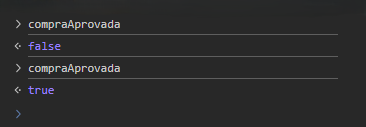
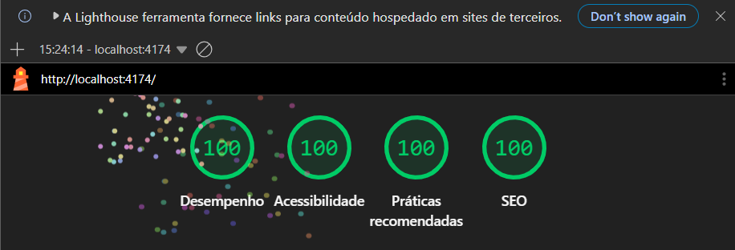

# 🛒 Checkout React

> Uma experiência de checkout simples, responsiva e acessível, desenvolvida com React.

---

## 👨‍💻 Sobre o autor

Olá! Eu sou **Paulo Filartiga**, estudante de Engenharia de Software e desenvolvedor em formação.

Este projeto foi desenvolvido para praticar conceitos fundamentais do React, como componentização, propriedades, estado, formulários, validação, rotas, processamento assíncrono e organização profissional com Git e GitHub.

🔗 [Meu perfil no GitHub](https://github.com/PauloFilartiga)

---

## 📖 Sobre o projeto

O **Checkout React** simula o fluxo de finalização de uma compra em uma loja virtual.

A aplicação apresenta um carrinho com produtos fixos, calcula os subtotais e o valor total da compra, recebe os dados do cartão e simula o processamento do pagamento.

O projeto não utiliza back-end nem integração com uma operadora de pagamentos. Todo o fluxo acontece no navegador para fins educacionais.

---

## 🎯 Problema proposto

Uma loja virtual precisa oferecer uma interface para que o cliente consiga:

- Conferir os produtos do carrinho;
- Visualizar quantidades, subtotais e total;
- Informar os dados do cartão;
- Receber mensagens claras de validação;
- Finalizar a compra;
- Visualizar o resultado da operação.

A aplicação também deve identificar como tentativa de golpe qualquer cartão que possua os 16 dígitos iguais.

---

## ⚙️ Como a aplicação funciona

O fluxo possui quatro páginas:

| Página    | Rota         | Finalidade                         |
| --------- | ------------ | ---------------------------------- |
| Carrinho  | `/`          | Exibe produtos, subtotais e total  |
| Pagamento | `/pagamento` | Recebe e valida os dados do cartão |
| Sucesso   | `/sucesso`   | Confirma a aprovação da compra     |
| Falha     | `/falha`     | Informa a tentativa de golpe       |

### Fluxo da compra

1. O cliente confere os produtos no carrinho;
2. Clica em **Finalizar compra**;
3. Preenche os dados do cartão;
4. O formulário valida os campos;
5. A aplicação simula o processamento durante 1,5 segundo;
6. O cliente é direcionado para a página de sucesso ou falha.

---

## 🛍️ Produtos do carrinho

| Produto          | Preço unitário |  Quantidade |      Subtotal |
| ---------------- | -------------: | ----------: | ------------: |
| Teclado mecânico |      R$ 249,90 |           1 |     R$ 249,90 |
| Mouse sem fio    |      R$ 129,90 |           2 |     R$ 259,80 |
| Headset gamer    |      R$ 319,90 |           1 |     R$ 319,90 |
| **Total**        |                | **4 itens** | **R$ 829,60** |

---

## 💳 Regras do pagamento

| Campo            | Regra                                      |
| ---------------- | ------------------------------------------ |
| Nome do titular  | Preenchimento obrigatório                  |
| Número do cartão | Exatamente 16 números                      |
| Validade         | Formato `MM/AA`, com mês entre `01` e `12` |
| CVV              | Exatamente 3 números                       |

### Regra de negócio

- Cartão com números diferentes: compra aprovada;
- Cartão com os 16 dígitos iguais: compra recusada;
- Durante o processamento, o botão fica desabilitado;
- Novos envios são bloqueados enquanto a operação está em andamento.

Exemplo de cartão aprovado:

```text
1234567890123456
```

Exemplo de cartão recusado:

```text
1111111111111111
```

---

## ✨ Funcionalidades

- Renderização dos produtos com `map`;
- Uso de chave estável em listas;
- Cálculo dos subtotais e total com `reduce`;
- Formatação dos valores em real brasileiro;
- Navegação entre quatro páginas;
- Formulário controlado pelo React Hook Form;
- Validação dos campos com Zod;
- Mensagens de erro acessíveis;
- Processamento assíncrono com `Promise` e `async/await`;
- Custom hook para a lógica do pagamento;
- Botão desabilitado durante o processamento;
- Resultado de sucesso ou tentativa de golpe;
- Interface responsiva para celular e computador.

---

## 🧠 Conceitos aplicados

| Conceito                 | Aplicação no projeto                 |
| ------------------------ | ------------------------------------ |
| Componentes funcionais   | Construção das páginas e componentes |
| JSX                      | Estrutura visual da aplicação        |
| Props                    | Comunicação entre os componentes     |
| Arrays e objetos         | Representação dos produtos           |
| `map`                    | Renderização da lista de produtos    |
| `reduce`                 | Cálculo de quantidades e valores     |
| Estado                   | Controle do processamento            |
| Eventos                  | Envio do formulário                  |
| Renderização condicional | Mensagens, erros e texto do botão    |
| React Hook Form          | Gerenciamento do formulário          |
| Zod                      | Validação dos dados                  |
| Custom Hook              | Lógica reutilizável do pagamento     |
| React Router             | Rotas e navegação                    |
| Promise                  | Simulação da compra                  |
| `async/await`            | Espera do processamento              |
| `try/finally`            | Controle seguro do estado            |
| Módulos ES               | Organização com `import` e `export`  |

---

## 🛠️ Tecnologias utilizadas


### Ferramentas


---

## 📁 Estrutura do projeto

```text
checkout-react/
├── docs/
│   └── images/
│       └── lighthouse-100.png
├── public/
│   └── robots.txt
├── src/
│   ├── assets/
│   │   └── styles/
│   │       └── index.css
│   ├── components/
│   │   ├── ItemCarrinho.jsx
│   │   └── ResumoCompra.jsx
│   ├── data/
│   │   └── produtos.js
│   ├── hooks/
│   │   └── usePagamento.js
│   ├── pages/
│   │   ├── Carrinho.jsx
│   │   ├── Pagamento.jsx
│   │   ├── Sucesso.jsx
│   │   └── Falha.jsx
│   ├── utils/
│   │   └── pagamento.js
│   ├── App.jsx
│   └── main.jsx
├── .gitignore
├── eslint.config.js
├── index.html
├── package-lock.json
├── package.json
├── README.md
└── vite.config.js
```

---

## 🚀 Como executar

### Pré-requisitos

Antes de começar, tenha instalado:

- Node.js;
- npm;
- Git.

### Clonando o repositório

```bash
git clone https://github.com/PauloFilartiga/checkout-react.git
```

Entre na pasta:

```bash
cd checkout-react
```

Instale as dependências:

```bash
npm install
```

Inicie o projeto:

```bash
npm run dev
```

Abra no navegador o endereço exibido pelo Vite, normalmente:

```text
http://localhost:5173
```

---

## 🧪 Testes e depuração

O fluxo foi testado manualmente durante o desenvolvimento:

- Carrinho com 3 produtos;
- Quantidade total de 4 itens;
- Valor total de R$ 829,60;
- Campos obrigatórios;
- Número do cartão com 16 dígitos;
- Validade no formato `MM/AA`;
- Validação do mês;
- CVV com 3 dígitos;
- Processamento assíncrono;
- Bloqueio de novos envios;
- Rotas de sucesso e falha;
- Links de retorno;
- Responsividade no celular e computador.

### Uso do debugger

O comando `debugger` foi inserido temporariamente após o processamento para inspecionar a variável `compraAprovada`.

| Cartão testado     | Valor encontrado | Resultado          |
| ------------------ | ---------------: | ------------------ |
| `1111111111111111` |          `false` | Tentativa de golpe |
| `1234567890123456` |           `true` | Compra aprovada    |

#### Evidência da depuração

A imagem abaixo mostra os valores de `compraAprovada` inspecionados no Console durante a pausa do debugger:



Após a verificação, o comando `debugger` foi removido.

### Verificação técnica

```bash
npm run lint
npm run build
```

Os dois comandos foram executados sem erros.

---

## 📊 Resultado do Lighthouse

A avaliação final foi executada utilizando o build de produção da aplicação.

| Desempenho | Acessibilidade | Práticas recomendadas | SEO |
| ---------: | -------------: | --------------------: | --: |
|        100 |            100 |                   100 | 100 |



---

## ♿ Acessibilidade e responsividade

A interface foi construída com foco em:

- HTML semântico;
- Títulos organizados por hierarquia;
- Associação entre `label` e campo;
- Mensagens de erro com `role="alert"`;
- Estado de processamento com `aria-busy`;
- Mensagem do botão com `aria-live`;
- Foco visível nos elementos interativos;
- Contraste entre textos e fundos;
- Layout mobile-first;
- Adaptação para telas maiores.

---

## 🌿 Versionamento com Git e GitHub

O desenvolvimento foi organizado com:

```text
branch de tarefa → develop → main
```

Branches utilizadas:

- `feat/estrutura-inicial`;
- `feat/dados-produtos`;
- `feat/carrinho-compras`;
- `feat/rotas-navegacao`;
- `feat/formulario-pagamento`;
- `feat/processamento-pagamento`;
- `feat/interface-responsiva`;
- `test/fluxo-completo`;
- `docs/readme`.

Cada funcionalidade foi testada antes do commit, push, Pull Request e merge na `develop`.

---

## 📋 Planejamento com Kanban

O projeto foi organizado em um quadro Kanban com as seguintes colunas:

- Backlog;
- A Fazer;
- Em andamento;
- Feito.

🔗 **Kanban do projeto:** [Acessar o quadro no Notion](https://wirehaired-kidney-ff1.notion.site/3d85701753e88009b603f2073512230e?v=2155701753e883eb88110822818f1dbd&pvs=143)

---

## 🤖 Uso de inteligência artificial

A inteligência artificial foi utilizada como ferramenta de apoio durante o desenvolvimento para:

- Organizar o projeto em etapas;
- Explicar conceitos do React;
- Sugerir melhorias de acessibilidade e responsividade;
- Auxiliar na investigação de erros;
- Orientar o uso do debugger;
- Revisar o fluxo de testes.

Todas as sugestões foram analisadas, digitadas, testadas e validadas pelo autor antes de serem adicionadas ao projeto.

A IA não substituiu o processo de aprendizagem nem a compreensão do código.

---

## 🎥 Vídeo de apresentação

O vídeo apresenta:

- Objetivo do projeto;
- Planejamento no Kanban;
- Organização das branches;
- Estrutura de pastas;
- Funcionamento do carrinho;
- Validação do formulário;
- Processamento da compra;
- Rotas de sucesso e falha;
- Responsividade;
- Uso do debugger;
- Possíveis melhorias.

[▶️ Assistir à apresentação do Checkout React](https://youtu.be/pq7iDY7OS_I)

---

## 🔮 Melhorias futuras

- Permitir alteração das quantidades;
- Adicionar e remover produtos;
- Consumir produtos de uma API;
- Persistir o carrinho no navegador;
- Criar testes automatizados;
- Adicionar uma página para rota inexistente;
- Integrar um back-end;
- Implementar uma operação real de pagamento.

---

## 📚 Aprendizados

Este projeto permitiu praticar a construção de uma aplicação React completa, desde a modelagem dos dados até a navegação e validação do pagamento.

Além da parte técnica, o desenvolvimento reforçou a importância de:

- Planejar antes de programar;
- Dividir o projeto em pequenas tarefas;
- Testar cada funcionalidade;
- Investigar erros com o debugger;
- Escrever commits claros;
- Utilizar branches e Pull Requests;
- Produzir uma documentação compreensível.

---

## 👨‍💻 Autor

**Paulo Filartiga**

Estudante de Engenharia de Software e desenvolvedor em formação.

[](https://github.com/PauloFilartiga)

---

## 💬 Considerações finais

O Checkout React representa mais uma etapa da minha evolução como desenvolvedor.

Cada componente, validação, teste e correção contribuiu para transformar os conteúdos estudados em uma aplicação funcional, organizada e compreensível.

> Mais importante do que apenas fazer funcionar é entender, testar e saber explicar o que foi construído.
