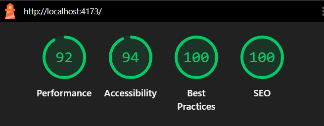

# 🖥️ Loja ByteForge

> E-commerce de hardware e periféricos desenvolvido com React: catálogo com busca e filtros, detalhe do produto, carrinho persistente e checkout com validação.

🔗 **Acesse o projeto publicado:** [loja-byteforge.vercel.app](https://loja-byteforge.vercel.app/)

---

## 👨‍💻 Sobre o autor

Olá! Eu sou **Paulo Filartiga**, estudante de Engenharia de Software e desenvolvedor em formação.

Este projeto é o mini-projeto do Módulo 2 e evolui o Checkout React do módulo anterior para uma loja completa, praticando consumo de API, Context API, rotas dinâmicas, rotas protegidas, testes automatizados, otimização de desempenho e deploy.

🔗 [Meu perfil no GitHub](https://github.com/PauloFilartiga)

---

## 📖 Sobre o projeto

A **ByteForge** simula uma loja virtual de hardware e periféricos para setup gamer e de trabalho.

O cliente navega pelo catálogo, busca e filtra produtos por categoria, consulta os detalhes de cada item, monta o carrinho e finaliza a compra com um formulário de pagamento validado.

Em desenvolvimento, os produtos vêm de uma API simulada com `json-server`. Em produção, a aplicação usa o mesmo `db.json` diretamente, sem depender de um servidor.

---

## 🎯 Problema proposto

Uma loja virtual precisa oferecer uma interface para que o cliente consiga:

- Navegar por um catálogo de produtos vindo de uma API;
- Buscar e filtrar produtos por nome e categoria;
- Ordenar os produtos por menor ou maior preço;
- Ver os detalhes de cada produto em uma página própria;
- Adicionar, remover e alterar a quantidade de itens no carrinho;
- Manter o carrinho salvo mesmo ao recarregar a página;
- Acessar o pagamento somente com itens no carrinho;
- Informar os dados do cartão com mensagens claras de validação;
- Visualizar o resultado da compra.

A aplicação também deve identificar como tentativa de golpe qualquer cartão que possua os 16 dígitos iguais.

---

## ⚙️ Como a aplicação funciona

A aplicação possui sete páginas:

| Página         | Rota              | Finalidade                                           |
| -------------- | ----------------- | ---------------------------------------------------- |
| Produtos       | `/` e `/produtos` | Catálogo com busca, filtro por categoria e ordenação |
| Detalhe        | `/produtos/:id`   | Informações completas de um produto                  |
| Carrinho       | `/carrinho`       | Itens, quantidades, subtotais e total                |
| Pagamento      | `/pagamento`      | Rota protegida: exige itens no carrinho              |
| Sucesso        | `/sucesso`        | Confirma a compra e esvazia o carrinho               |
| Falha          | `/falha`          | Informa a tentativa de golpe e mantém o carrinho     |
| Não encontrada | `*`               | Página para rotas inexistentes                       |

### Fluxo da compra

1. O cliente navega pelo catálogo, usando busca, filtro e ordenação;
2. Abre a página de detalhe de um produto;
3. Adiciona produtos ao carrinho, que fica salvo no navegador;
4. Ajusta as quantidades ou remove itens no carrinho;
5. Avança para o pagamento, liberado somente com itens no carrinho;
6. Preenche os dados do cartão, validados em tempo real;
7. A aplicação simula o processamento;
8. O cliente é direcionado para a página de sucesso ou de falha.

---

## 🛍️ Produtos do carrinho

| Produto          | Preço unitário |  Quantidade |      Subtotal |
| ---------------- | -------------: | ----------: | ------------: |
| Teclado mecânico |      R$ 249,90 |           1 |     R$ 249,90 |
| Mouse sem fio    |      R$ 129,90 |           2 |     R$ 259,80 |
| Headset gamer    |      R$ 319,90 |           1 |     R$ 319,90 |
| **Total**        |                | **4 itens** | **R$ 829,60** |

---

## 💳 Regras do pagamento

| Campo            | Regra                                      |
| ---------------- | ------------------------------------------ |
| Nome do titular  | Preenchimento obrigatório                  |
| Número do cartão | Exatamente 16 números                      |
| Validade         | Formato `MM/AA`, com mês entre `01` e `12` |
| CVV              | Exatamente 3 números                       |

### Regra de negócio

- Cartão com números diferentes: compra aprovada;
- Cartão com os 16 dígitos iguais: compra recusada;
- Durante o processamento, o botão fica desabilitado;
- Novos envios são bloqueados enquanto a operação está em andamento.

Exemplo de cartão aprovado:

```text
1234567890123456
```

Exemplo de cartão recusado:

```text
1111111111111111
```

---

## ✨ Funcionalidades

- Catálogo consumido de uma API simulada com `json-server`;
- Fallback para o `db.json` quando a API não está disponível;
- Busca por nome com debounce, evitando filtrar a cada tecla;
- Busca sincronizada com a URL (`/produtos?busca=...`), permitindo compartilhar o resultado;
- Filtro por categoria e ordenação por menor ou maior preço;
- Página de detalhe com rota dinâmica;
- Carrinho global com Context API, persistido no `localStorage`;
- Adição, remoção e alteração de quantidades;
- Contador de itens no cabeçalho;
- Rota protegida para o pagamento;
- Formulário com React Hook Form e validação com Zod;
- Processamento assíncrono com botão bloqueado durante o envio;
- Tema claro e escuro;
- Página para rotas inexistentes;
- Imagens responsivas e otimizadas;
- Interface responsiva e acessível.

---

## 🧠 Conceitos aplicados

| Conceito                 | Aplicação no projeto                                      |
| ------------------------ | --------------------------------------------------------- |
| Componentes funcionais   | Páginas e componentes reutilizáveis                       |
| Props e PropTypes        | Comunicação e validação dos dados entre componentes       |
| Context API              | Estado global do carrinho e do tema                       |
| Custom Hooks             | `useCarrinho`, `useTema`, `useDebounce`, `usePagamento`   |
| `useEffect`              | Busca de dados e persistência no `localStorage`           |
| `useMemo`                | Cálculo otimizado do total e da quantidade                |
| React Router             | Rotas dinâmicas, rota 404 e rota protegida                |
| `fetch` e `async/await`  | Consumo da API de produtos                                |
| `try/catch`              | Tratamento de erros e fallback                            |
| React Hook Form + Zod    | Formulário e validação do pagamento                       |
| Renderização condicional | Carregamento, erros, carrinho vazio e resultado           |
| Variáveis de ambiente    | `import.meta.env` para separar desenvolvimento e produção |
| `srcset` e `sizes`       | Imagens no tamanho certo para cada tela                   |
| Testes automatizados     | Vitest e React Testing Library                            |

---

## 🛠️ Tecnologias utilizadas


### Ferramentas


---

## 📁 Estrutura do projeto

```text
loja_byteforge/
├── docs/
│   └── images/
├── public/
│   ├── _redirects
│   ├── apple-touch-icon.png
│   └── favicon-32.png
├── src/
│   ├── __tests__/
│   │   └── componentes.test.jsx
│   ├── assets/
│   │   ├── images/
│   │   └── styles/
│   │       └── index.css
│   ├── components/
│   │   ├── Footer.jsx
│   │   ├── Header.jsx
│   │   ├── ItemCarrinho.jsx
│   │   ├── Layout.jsx
│   │   ├── ProdutoCard.jsx
│   │   ├── ResumoCompra.jsx
│   │   └── RotaPrivada.jsx
│   ├── contexts/
│   │   ├── CarrinhoContext.js
│   │   ├── CarrinhoProvider.jsx
│   │   ├── TemaContext.js
│   │   └── TemaProvider.jsx
│   ├── hooks/
│   │   ├── useCarrinho.js
│   │   ├── useDebounce.js
│   │   ├── usePagamento.js
│   │   └── useTema.js
│   ├── pages/
│   │   ├── Carrinho.jsx
│   │   ├── Falha.jsx
│   │   ├── NaoEncontrada.jsx
│   │   ├── Pagamento.jsx
│   │   ├── ProdutoDetalhe.jsx
│   │   ├── Produtos.jsx
│   │   └── Sucesso.jsx
│   ├── services/
│   │   └── api.js
│   ├── utils/
│   │   ├── __tests__/
│   │   ├── busca.js
│   │   ├── carrinho.js
│   │   ├── imagem.js
│   │   ├── moeda.js
│   │   └── pagamento.js
│   ├── App.jsx
│   ├── main.jsx
│   └── setupTests.js
├── db.json
├── eslint.config.js
├── index.html
├── package.json
├── vercel.json
└── vite.config.js
```

---

## 🚀 Como executar

### Pré-requisitos

Antes de começar, tenha instalado:

- Node.js;
- npm;
- Git.

### Clonando o repositório

```bash
git clone https://github.com/PauloFilartiga/Loja-ByteForge.git
```

Entre na pasta:

```bash
cd Loja-ByteForge
npm install
```

I### Rodando em desenvolvimento

O projeto precisa de **dois terminais** abertos ao mesmo tempo.

No primeiro, inicie a API simulada:

```bash
npm run api
```

No segundo, inicie a aplicação:

```bash
npm run dev
```

Abra no navegador o endereço exibido pelo Vite, normalmente:

```text
http://localhost:5173
```

Se a API não estiver rodando, a aplicação usa os dados do `db.json` automaticamente.

### Scripts disponíveis

| Comando           | Descrição                                 |
| ----------------- | ----------------------------------------- |
| `npm run dev`     | Inicia o servidor de desenvolvimento      |
| `npm run api`     | Inicia o json-server na porta 3001        |
| `npm test`        | Executa os testes automatizados           |
| `npm run lint`    | Verifica a qualidade do código            |
| `npm run build`   | Gera a versão de produção na pasta `dist` |
| `npm run preview` | Executa localmente a versão de produção   |

---

## 🧪 Testes

O projeto possui **21 testes automatizados** em 3 arquivos, escritos com Vitest e React Testing Library:

| Arquivo                              | O que é testado                                            |
| ------------------------------------ | ---------------------------------------------------------- |
| `src/utils/__tests__/utils.test.js`  | Formatação de moeda, busca, carrinho e pagamento           |
| `src/utils/__tests__/imagem.test.js` | Otimização das URLs de imagem e geração do `srcset`        |
| `src/__tests__/componentes.test.jsx` | Renderização e interação do `ProdutoCard` e `ItemCarrinho` |

Os testes cobrem o caminho feliz e os casos de erro, como valores inválidos, URLs de outros domínios e cartões com dígitos repetidos.

```bash
npm test
```

### Testes manuais

Além dos testes automatizados, o fluxo completo foi validado no navegador:

- Acesso direto a `/pagamento` com o carrinho vazio redireciona para `/carrinho`;
- O total do pagamento corresponde ao total do carrinho;
- Compra aprovada esvazia o carrinho;
- Compra recusada mantém os itens no carrinho;
- Recarregar uma página interna funciona no site publicado.

---

## 📊 Resultado do Lighthouse

A avaliação foi executada no build de produção (`npm run preview`), em aba anônima.

| Momento              | Desempenho | Acessibilidade | Práticas recomendadas |     SEO |
| -------------------- | ---------: | -------------: | --------------------: | ------: |
| Antes da otimização  |         54 |             94 |                    77 |     100 |
| Depois da otimização |     **92** |        **100** |                    94 | **100** |

As principais melhorias foram:

- Imagens do Unsplash entregues no tamanho exibido e em formato AVIF, reduzindo a economia estimada de 456 KiB para 31 KiB;
- Prioridade de carregamento para as primeiras imagens do catálogo (LCP);
- Favicon de 1,5 MB substituído por um PNG de 3 kB;
- Correção de um `<main>` aninhado na página de pagamento.



---

## ♿ Acessibilidade e responsividade

A interface foi construída com foco em:

- HTML semântico;
- Títulos organizados por hierarquia;
- Associação entre `label` e campo;
- Mensagens de erro com `role="alert"`;
- Estado de processamento com `aria-busy`;
- Mensagem do botão com `aria-live`;
- Foco visível nos elementos interativos;
- Contraste entre textos e fundos;
- Layout mobile-first;
- Adaptação para telas maiores.

---

## 🌿 Versionamento com Git e GitHub

O desenvolvimento foi organizado com o fluxo:

```text
branch de tarefa → develop → main
```

Cada card do Kanban teve sua própria branch, e toda alteração passou por teste, commit, push e Pull Request antes do merge na `develop`. A `main` recebe apenas a versão final e é publicada automaticamente na Vercel.

Branches do projeto ByteForge:

| Card | Branch                          | Objetivo                                         |
| :--: | ------------------------------- | ------------------------------------------------ |
|  1   | `feat/api-simulada-e-setup`     | Configuração inicial e API com json-server       |
|  2   | `feat/utils-e-testes`           | Funções utilitárias e testes unitários           |
|  2   | `feat/suporte-multiplas-moedas` | Formatação de valores em BRL, USD e EUR          |
|  3   | `feat/servico-api`              | Camada de serviço com fetch e fallback           |
|  4   | `feat/carrinho-context`         | Carrinho global com Context API e persistência   |
|  5   | `feat/tema-context`             | Tema claro e escuro                              |
|  6   | `feat/layout-footer`            | Layout base, Header e Footer                     |
|  7   | `feat/catalogo-e-busca`         | Catálogo com busca, debounce, filtro e ordenação |
|  8   | `feat/detalhe-produto-e-404`    | Página de detalhe e rota inexistente             |
|  9   | `feat/carrinho-e-rota-privada`  | Tela do carrinho e rota privada de checkout      |
|  10  | `test/componente-catalogo`      | Testes de componentes com Testing Library        |
|  11  | `docs/readme-e-deploy`          | Build, deploy e documentação final               |
|  12  | `fix/rota-privada-pagamento`    | Correção da rota protegida e do total            |
|  13  | `perf/otimizacao-imagens`       | Otimização de imagens para o Lighthouse          |

Os prefixos seguem o padrão Conventional Commits: `feat` para funcionalidades, `fix` para correções, `test` para testes, `perf` para desempenho e `docs` para documentação.

---

## 📋 Planejamento com Kanban

O projeto foi planejado em um quadro Kanban no Notion, com **13 cards**. Cada card registra a descrição da tarefa, o estado, o responsável e a branch correspondente no Git.

O quadro possui as colunas:

- Backlog;
- A Fazer;
- Em andamento;
- Feito.

Os cards marcados como **[Bônus]** são funcionalidades extras além do mínimo pedido, e os cards **[Fix]** e **[Perf]** foram criados durante a revisão final, registrando correções e otimizações encontradas com testes e com o Lighthouse.

🔗 **Kanban do projeto:** [Acessar o quadro no Notion](https://wirehaired-kidney-ff1.notion.site/8765701753e88307afa701620249257a?v=d775701753e88371a7d2086435f7a796)

---

## 🤖 Uso de inteligência artificial

A inteligência artificial foi utilizada como ferramenta de apoio para:

- Revisar o código antes da entrega, o que revelou uma rota de pagamento duplicada sem proteção e o pagamento usando dados fixos;
- Investigar o relatório do Lighthouse e otimizar a entrega das imagens;
- Explicar conceitos como `srcset`, `sizes`, `fetchPriority` e `import.meta.env`;
- Configurar o deploy na Vercel e o roteamento das páginas internas;
- Organizar o fluxo de branches e os cards de correção no Kanban;
- Apoiar a escrita da documentação.

Todo o código sugerido foi digitado, testado etapa por etapa e validado pelo autor antes de cada commit. A documentação foi revisada e ajustada para refletir o projeto real.

A IA não substituiu o processo de aprendizagem nem a compreensão do código.

---

### Roteiro da apresentação

O vídeo apresenta:

1. **Introdução:** apresentação pessoal e objetivo da ByteForge;
2. **Planejamento:** quadro Kanban no Notion e a relação entre cards e branches;
3. **Estrutura do código:** organização das pastas, contexts, hooks, services e utils;
4. **Catálogo:** busca com debounce, filtro por categoria e ordenação por preço;
5. **Detalhe e 404:** rota dinâmica e página de rota inexistente;
6. **Carrinho:** adição, quantidades, remoção e persistência ao recarregar;
7. **Checkout:** rota protegida, validação do formulário, compra aprovada e recusada;
8. **Tema:** alternância entre claro e escuro;
9. **Qualidade:** execução dos testes e comparação do Lighthouse antes e depois;
10. **Deploy:** site publicado na Vercel;
11. **Encerramento:** aprendizados e melhorias futuras.

[▶️ Assistir à apresentação] [YouTube](https://youtu.be/ddG2-Qr4CQM)

---

## 🔮 Melhorias futuras

- Exibir os preços em dólar e euro com cotação em tempo real, aproveitando a função `formatarMoeda`, que já suporta BRL, USD e EUR;
- Reorganizar os componentes no padrão Atomic Design (atoms, molecules e organisms);
- Integrar um back-end real e um meio de pagamento;
- Adicionar autenticação de usuários e histórico de pedidos;
- Ampliar a cobertura de testes para as páginas.

---

## 📚 Aprendizados

Este projeto permitiu evoluir uma aplicação React simples para uma loja completa, com dados vindos de uma API, estado global, rotas protegidas, testes automatizados e publicação na internet.

Além da parte técnica, o desenvolvimento reforçou a importância de:

- Planejar antes de programar;
- Dividir o projeto em pequenas tarefas;
- Testar cada funcionalidade;
- Investigar erros com o debugger;
- Escrever commits claros;
- Utilizar branches e Pull Requests;
- Produzir uma documentação compreensível.
- Revisar o projeto antes de entregar, registrando as correções no Kanban;
- Medir o desempenho com dados reais antes de otimizar.

---

## 👨‍💻 Autor

**Paulo Filartiga**

Estudante de Engenharia de Software e desenvolvedor em formação.

[](https://github.com/PauloFilartiga)

---

## 💬 Considerações finais

O A ByteForge representa representa mais uma etapa da minha evolução como desenvolvedor.

Cada componente, validação, teste e correção contribuiu para transformar os conteúdos estudados em uma aplicação funcional, organizada e compreensível.

> Mais importante do que apenas fazer funcionar é entender, testar e saber explicar o que foi construído.
